# 3d-print-ring-camera

An angled mounting block for a Ring camera. It screws on through its side and
turns the camera 8° away from the mounting surface. A pocket behind the camera
holds the wiring, and an 8 mm hole carries the cable in from the back.

Four print options:

Each option has its own folder: `option1-solid/`, `option2-hinge/`,
`option3-dovetail/`, `option4-pivot/`. Everything for that option lives in
it: the model, a print file for each part, the STLs and the preview images.

1. **[Solid block](#option-1-solid-block)** (`option1-solid/`, primary): one piece, fixed 8°.
2. **[Adjustable hinge](#option-2-adjustable-hinge)** (`option2-hinge/`, secondary): a camera
   shell that pivots over a base, set from 3° to 15° in 2° clicks.
3. **[Dovetail slide](#option-3-dovetail-slide)** (`option3-dovetail/`, secondary): adjustable 3°–15°
   with **no metal hardware** apart from the two screws into the wall. The
   shell slides on curved dovetail rails and locks with a printed pin.
4. **[Pivot with roof](#option-4-pivot-with-roof)** (`option4-pivot/`, secondary): the base screws on
   first and has a roof. The shell slides up under it, pivots on an M5
   screw, and locks with a toothed washer and thumb screw: 3° to 15° in 3°
   clicks.

**[View the solid block in 3D →](option1-solid/stl/block.stl)** (GitHub shows STL files in an interactive viewer)

**Video:** [`docs/video/ring-mount-options.mp4`](docs/video/ring-mount-options.mp4)
is a 6-minute narrated walkthrough of all four options: the sketch, how each one installs, turns and holds together. The storyboard and
script are in [`docs/video/storyboard.md`](docs/video/storyboard.md).

**Animated demo:** [`demo.html`](demo.html) plays the same walkthrough
interactively from the real STLs, with chapters. To watch it locally, serve
the repo folder (`python -m http.server 8765 --bind 127.0.0.1`) and open
`http://localhost:8765/demo.html`. It is also published as a private Claude
artifact. Before republishing, regenerate its model pack with
`python tools/pack_demo.py <out.js>`, because the artifact host doesn't
serve `.stl` files.

**Remaking the video** (after a design change; no installs):

1. `python tools/make_narration.py` speaks the storyboard's narration with
   Windows' built-in voice into `docs/video/narration/`. Pass a voice name
   to change it; Zira is the default.
2. `python tools/video_server.py`, then open
   `http://localhost:8765/demo.html?record` in Edge or Chrome. The page
   renders every frame, encodes the MP4 in the browser and saves it to
   `docs/video/` (about 2 minutes). If a narration line is longer than its
   scene, it stops and says which scene. Lengthen that scene in `demo.html`
   (`S`) and in the storyboard.

Original hand sketch: [docs/sketch.webp](docs/sketch.webp).

## Option 1: solid block

| 3D | Camera face | Countersink side | Top |
|---|---|---|---|
| 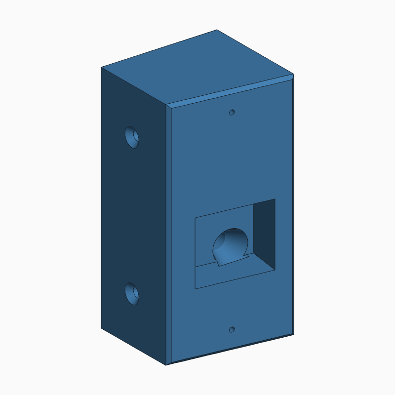 | 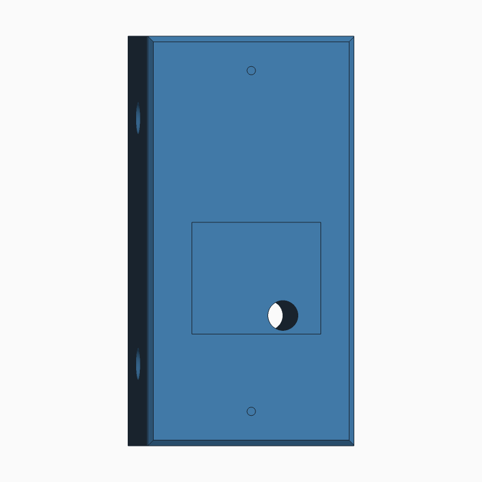 | 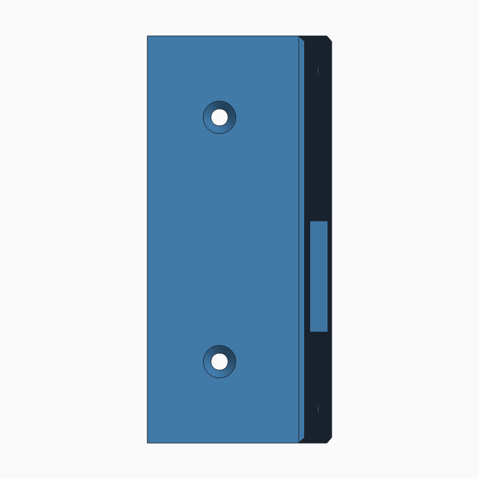 | 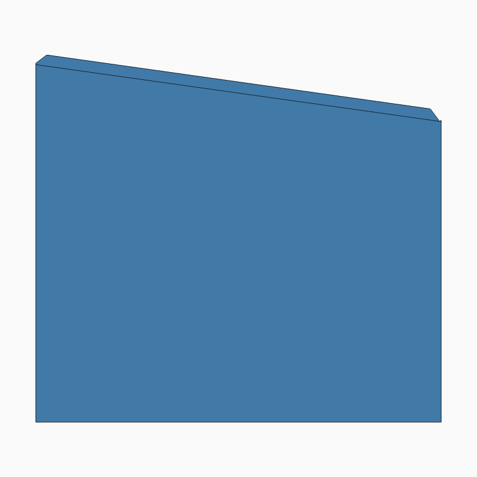 |

Back face (cable entry): [option1-solid/docs/block-back.png](option1-solid/docs/block-back.png).

- **Files:** model `option1-solid/option1_solid.scad` · print file
  `option1-solid/prints/block.scad` · STL `option1-solid/stl/block.stl`.
- **Sizes (Cat, 2026-11-02):**
  - **Block:** 50 mm deep at the mounting side (the sketch scaled to 46).
  - **Wiring pocket:** its back wall is parallel to the block's back, as the
    sketch drew it. It's 17 mm deep at its shallowest point, growing to about
    21.9 mm at the deep side (calculated). Options 2–4 keep a 15 mm pocket
    parallel to the face.
  - **Cable hole:** opens into the pocket through a funnel that widens from
    8 to 15 mm, so the wire bends gently. The funnel is trimmed flat at the
    pocket floor: it flares on the top and sides, and stops at the floor
    instead of cutting into it. The build checks that. Its rim has a 1.5 mm
    45° chamfer (`cable_mouth_chamfer`), so the wire meets no sharp edge.
    The pocket wall is square to the cable hole, so the funnel's rim is
    centred on the hole at any face angle.
  - **Screws:** stay 19.5 mm from the back.
- **Checked by `build.ps1`:**
  - The pocket and the funnel keep at least 4 mm of plastic around both
    screw holes (5.5–6 mm as built, measured by the check).
  - The funnel doesn't cut into the pocket floor.
  - A must-fail test for each proves the check can fail.
- **Tinkercad:** Import (top right) → choose `option1-solid/stl/block.stl` → units mm.
- **Slicer:** print lying on the **back face** (flat, 55 × 110). In that
  position the pocket opens upward and no supports should be needed. Not yet
  test-printed.
- **Material:** for an outdoor mount, PETG or ASA. PLA softens in sun.
  Dremel Eco-ABS: see the material note under the adjustable mount.

## Option 2: adjustable hinge

| 3° | 15° | Angle scale (side) | Fit test |
|---|---|---|---|
|  |  | 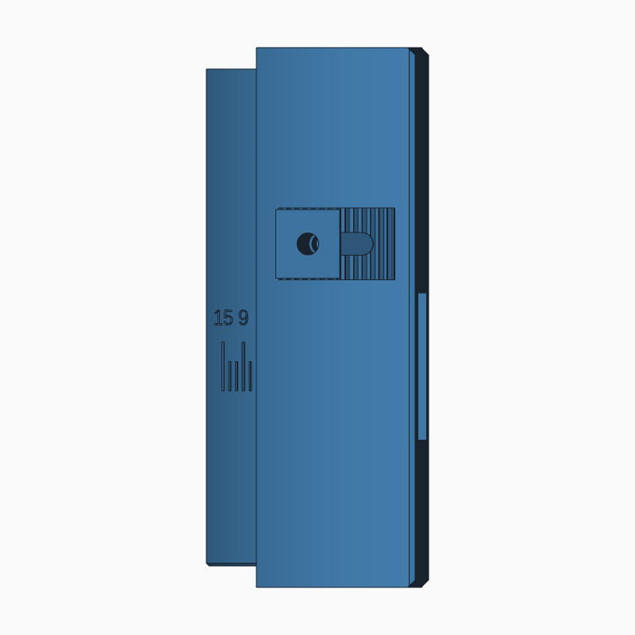 | 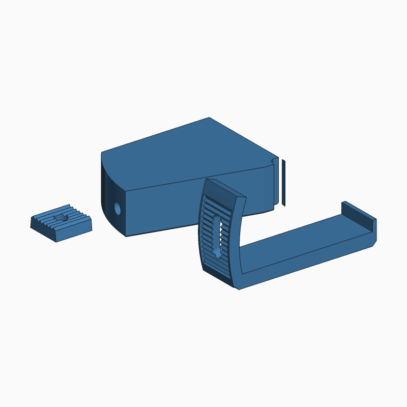 |

3D: [at 3°](option2-hinge/stl/assembly_3.stl) · [at 15°](option2-hinge/stl/assembly_15.stl)
(viewing only; print the parts below).

**How it works.** The **base** screws to the surface exactly like the solid
block: deep side against the surface, two screws through the width, cable in
through the back. The **shell** carries the Ring. It pivots on two M4 bolts
(top and bottom) and wraps over the base, so it looks like one block at every
angle and the base's screw heads end up hidden. The base's shallow end is a
cylinder centred on the hinge, so the shell's curved skirt slides over it with
a constant gap. A **toothed washer** under one clamp bolt locks into teeth on
the skirt: one tooth = 2°. The teeth take the load, not clamp friction, which
matters because plastic slowly creeps under constant load outdoors. **Reading
the angle:** the trailing edge of the skirt points at a scale engraved on the
base (3, 9, 15, with ticks every 2°).

### Parts and print orientation

| STL | Print orientation (as exported) |
|---|---|
| `option2-hinge/stl/fit_test.stl` | **Print this first.** A 16 mm slice through the clamp: base puck, skirt with teeth and slot, washer. Use it to check the slide and the tooth mesh, and tune tolerances, before the full parts. |
| `option2-hinge/stl/base.stl` | Standing on its bottom face, so the cylinder prints round. |
| `option2-hinge/stl/shell.stl` | Camera face down. |
| `option2-hinge/stl/washer.stl` | Flat face down, teeth up. |

### Hardware (stainless, A2 or A4)

- 2× M4 × 16 bolts: hinge
- 1× M4 × 20 bolt: clamp
- 3× M4 hex nuts: captive in the base
- 2× #8 flat (bevel) head wood screws, about 65 mm (2½ in) long: base to
  surface. The head seats 40 mm into the base (`screw_seat_x`), in an 82°
  countersink.

Bolt lengths are calculated from the model, not yet tested.

### Assembly `[unverified: not yet test-assembled]`

1. Press the two hinge nuts into the slots on the base's mounting face, and
   the clamp nut into the slot on its back face. Each is held captive once the
   base is against the surface or wall.
2. Feed the cable through the back, then screw the base to the surface through
   the two counterbores on its curved side.
3. Slide the shell onto the base from the open, curved side. Line up the hinge
   holes and fit the hinge bolts from the top and from the bottom.
4. Turn the shell to the angle you want and drop the washer into the toothed
   track. Fit the clamp bolt through the washer and the slot into the nut, and
   tighten.
5. Wire the Ring through the window in the shell's camera plate, then screw it
   to the shell.

### Print tolerances

All clearances live in one section at the top of `option2-hinge/option2_hinge.scad`
(`/* [Print tolerances] */`). They are starting values for a 0.4 mm nozzle,
not yet tuned to the DigiLab 3D45:

| Value | Default | Governs |
|---|---|---|
| `gap` | 0.4 | skirt over base, plates over base |
| `tooth_clr` | 0.25 | washer teeth in skirt teeth |
| `bolt_d` | 4.5 | M4 holes |
| `nut_af` / `nut_t` | 7.4 / 3.6 | captive nut slots |
| `washer_side` | 0.3 | washer in its track |
| `swing_clr` | 1.0 | camera plate and Ring bosses vs base, through the swing |
| `foot_chamfer` | 0.5 | base bottom edge, against first-layer squash ("elephant's foot") |

The build's collision check proves the parts clear each other at all seven
settings **at nominal size only**. Real fit needs the fit test.

### Material note

Dremel Eco-ABS is fine for the fit test and a prototype. For outdoor use it is
questionable: a retailer lists its heat deflection at about 78 °C
(unverified). A dark part on a sunny wall can reach 60–70 °C under constant
clamp load, and there is no UV rating. One user review says it is a modified
PLA rather than ABS. Use **PETG** for the outdoor part (the 3D45 prints it),
and prefer a light colour, which runs cooler in sun.

## Option 3: dovetail slide

| 3° | 15° | Underside: lock pin and labels | Fit test |
|---|---|---|---|
|  | 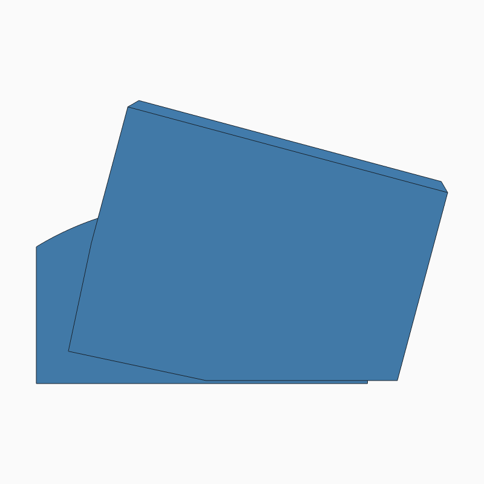 |  |  |

3D: [at 3°](option3-dovetail/stl/assembly_3.stl) · [at 15°](option3-dovetail/stl/assembly_15.stl)
(viewing only; print the parts below).

**How it works.** The base's front is a curve around a virtual pivot behind
the wall, carrying two curved dovetail rails. The shell's back has matching
grooves. Sliding the shell along the rails turns the camera away from the
mounting surface. The dovetails hold the shell in every other direction, so
there is no hinge and no bolt. **Locking:** a printed pin pushes up from
underneath. The shell's bottom has 7 holes, each engraved with its angle.
Under them, the base has 7 holes laid out so each pair lines up at exactly
one angle. Slide until the pin goes into the hole marked with the angle you
want. The grooves' closed end stops the slide just past 15°. **Weather:**
hoods cover the base's top and bottom, the pin holes face down, and there is
a drain.

| STL | Print orientation (as exported) |
|---|---|
| `option3-dovetail/stl/fit_test.stl` | **Print this first.** The bottom 26 mm of base and shell plus a pin: checks the dovetail slide and the pin fit. |
| `option3-dovetail/stl/base.stl` | Standing on its bottom face. Rails print without supports (30° flanks). |
| `option3-dovetail/stl/shell.stl` | Camera face down. |
| `option3-dovetail/stl/pin.stl` | Lying on a small flat, so layers run along the pin (strongest in shear). |

**Hardware:** 2 wood screws (about Ø3.5 × 65 mm: the head seats 40 mm into
the base at `screw_seat_x`, plus about 25 mm into the frame). Nothing else.

**Assembly** `[unverified: not yet test-assembled]`:

1. On the bench, slide the shell onto the base's rails from the open side,
   to 3°, and push the pin into the hole marked 3.
2. Feed the cable through the back. Hold the mount in the corner and drive
   the two screws through the counterbores on its open side. At 3° they
   sit below the shell.
3. To set the angle: pull the pin out from below, slide the shell, and push
   the pin into the hole for the new angle.
4. Wire the camera through the window and screw it to the face.

**Same as options 1 and 2** (from `mount_common.scad`): the Ring holes, the
pocket, and the cable hole position (17 mm from the deep side, 35 mm up),
which has to match where the wire leaves the wall, and the screw size.
**Chosen for this design:** the mounting screws sit 13 mm from the back
(options 1 and 2: 19.5), so the heads are below the shell's path, with 8.5 mm
of plastic behind each counterbore. Screw
positions aren't fixed; only their size is. The shell is up to 69 mm wide at
15° because it slides toward the open side.

**Checks in `build.ps1`:** no collisions at all seven angles with the pin in
its hole, and a wrong-hole test (shell at 5°, pin in the "3" hole) that must
be blocked. That second test proves the check can fail.

## Option 4: pivot with roof

| 3° | 15° | Underside: slot, washer, screws | Fit test |
|---|---|---|---|
| 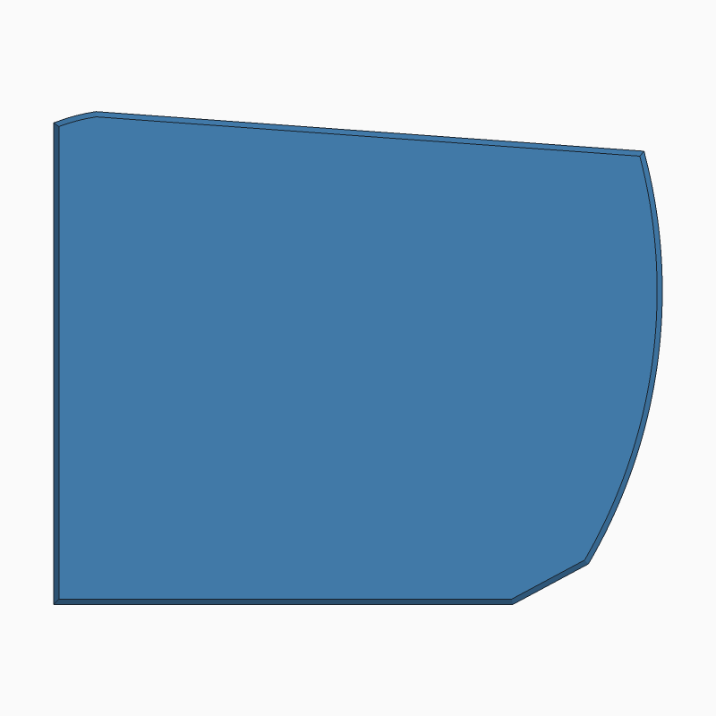 | 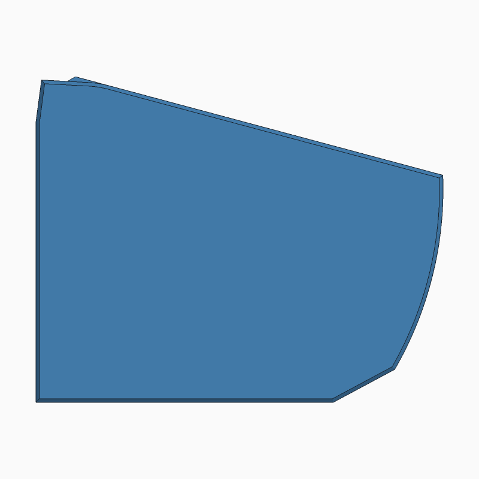 | 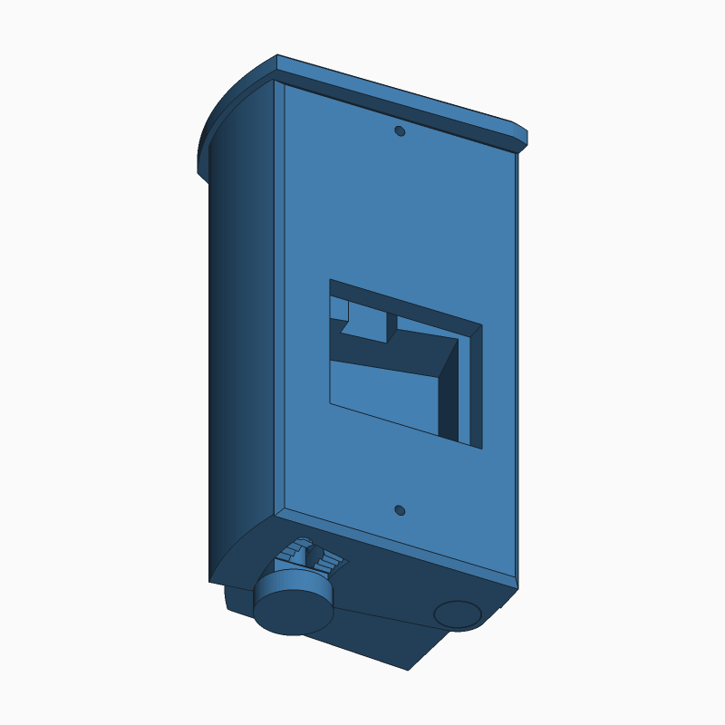 | 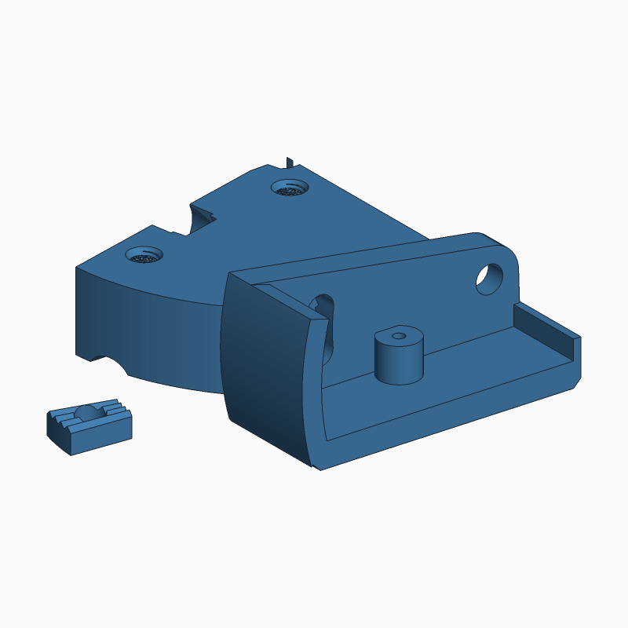 |

3D: [at 3°](option4-pivot/stl/assembly_3.stl) · [at 15°](option4-pivot/stl/assembly_15.stl)
(viewing only; print the parts below).

**How it works.** The **base** screws to the surface first, with nothing in
the way. Its top is a **roof** that covers the shell at every angle, so rain
can't get in from above. At steep angles it overhangs the camera face like a
small visor (up to about 11 mm at the shallow end at 15°). The Ring is
smaller than the face, so it stays below the roof. The **shell** carries the Ring. It slides up
from below at 9° (the Ring bosses pass up a channel in the base) until it
sits under the roof. An M5 countersunk slotted screw from below, the
**pivot screw**, goes through the shell's bottom plate into a thread in the
base on the hinge axis. Its head sits flush in the plate, so nothing sticks
out near the mounting surface, which is only 6.5 mm from the axis. Adjusting
never touches it.
A second M5 thumb screw, the **lock screw**, goes up through a printed
**toothed washer** and a curved slot in the bottom plate into another thread
in the base. Tightening it pulls the washer's teeth into teeth on the plate's
underside: one tooth = 3°. The screw holds the angle in shear, so the teeth
take the load, not clamp friction. The threads are modelled in the print.

**Adjusting:** loosen the lock screw about 2 turns. The washer drops off the
teeth but stays in its track, so it can't spin or fall off. Turn the shell,
then tighten. The shell doesn't drop, and the pivot screw stays snug.
**Reading the angle:** the skirt's trailing edge points at a scale engraved
on the base (3, 9, 15, with ticks every 3°).

| STL | Print orientation (as exported) |
|---|---|
| `option4-pivot/stl/fit_test.stl` | **Print this first.** The bottom 16 mm of the base (both threads), the bottom of the shell (plate, teeth, slot) and a washer. Check that the thumb screws thread in, that the washer seats at each click, and that the skirt slides. |
| `option4-pivot/stl/base.stl` | Roof down, so the roof is the flat first layer and the threads print vertical. |
| `option4-pivot/stl/shell.stl` | Camera face down. |
| `option4-pivot/stl/washer.stl` | Flat face down, teeth up. |

**Hardware (stainless, A2 or A4):**

- 1× M5 × 20 countersunk slotted screw (ISO 2009, 90°, 9.2 mm head): pivot. It sits flush in the shell's bottom plate.
- 1× M5 × 20 knurled thumb screw: lock. The model allows a head up to
  16 mm (`lock_head_d`); check the one you buy.
- Buy both M5 screws **with a nylon locking patch** (chosen by Cat): a
  pre-applied strip of nylon on the thread that resists vibration loosening.
  They still turn by hand or with a hex key, and the model doesn't change.
  Don't use liquid threadlocker: it's likely to crack ABS and PETG.
- 2× #8 flat (bevel) head wood screws, about 75 mm (3 in) long. The head
  seats 49 mm into the base (`screw_seat_x`), in an 82° countersink.

Lengths are calculated from the model, not tested. Thread engagement: about
13.6 mm (pivot) and 10.4 mm (lock) when locked. With the lock loosened it
still has about 8.8 mm.

**Assembly** `[unverified: not yet test-assembled]`:

1. Feed the cable through the back. Screw the base to the surface through
   the two counterbores on its curved side.
2. Turn the shell to 9° and slide it up onto the base from below, until it
   stops under the roof.
3. Fit the pivot screw up through the hole at the shell's deep corner and
   tighten it snug with a flat screwdriver. The head sits flush.
4. Turn the shell to the angle you want. Put the washer in its track, teeth
   up, and fit the lock screw through it and the slot. Tighten.
5. Wire the Ring through the window in the shell's camera plate, then screw
   it to the shell.

**Chosen for this design:** the mounting screws sit at 25 and 88 mm (options
1 and 2: 22 and 88). The lower screw moved up 3 mm to leave 4 mm of plastic
above the lock thread. Screw positions aren't fixed; only their size is.

**Checks in `build.ps1`:**

- No collisions at all five angles. The wall, the mounting surface and the
  screw heads count as solids.
- A half-tooth angle (4.5°) that must collide. This proves the check can
  fail.
- The shell slides up onto the base at the install angle, checked from
  2 mm to 95 mm below its seat.

## Changing the design

The `.scad` files are the single source of truth. The STLs and preview
images are generated from them. Never edit those by hand.

| File | Owns |
|---|---|
| `mount_common.scad` | **Fixed measurements shared by all four options**: envelope, Ring holes (91.5 mm apart), pocket, cable hole, mounting screw size. Change one here and every option follows; the build fails if a model redefines one. Screw *positions* are not fixed, so each model sets its own. |
| `option<N>-<name>/option<N>_<name>.scad` | The option's **model**: every design value and print tolerance, at the top of the file. `part` selects what it renders (base / shell / … / assembly / clash). |
| `option<N>-<name>/prints/<part>.scad` | A **print file** for one STL. It loads the model, picks the part, and is where you change a value **for that one print only** (see below). |
| `option<N>-<name>/stl/`, `docs/` | Generated: STLs and preview images. Never edit by hand. |

### Changing one print

Open the part's print file in OpenSCAD, for example
`option4-pivot/prints/base.scad`. Uncomment a setting, or add any value
from the option's model file. Press F6, then File → Export → STL. In
OpenSCAD the last value set wins, so the change only affects that print.

Two rules, enforced by `tools/check_prints.py` at the start of every build:

- A print file can't change a **fixed measurement** from `mount_common.scad`.
  The build fails.
- A **print tolerance that two parts share** (for example `gap`, or the tooth
  clearance) has to match on both parts, so change it in the model file. The
  build warns if a print file sets one.

### Changing the design

1. Edit a value at the top of the option's model file. To see it live, open
   the file in OpenSCAD (Start menu → OpenSCAD (Nightly)) and press F5.
2. Rebuild everything:

   ```bash
   powershell -ExecutionPolicy Bypass -File .uild.ps1
   ```

   - It checks the print files, then exports every STL from them.
   - It renders each option's `docs/*.png` previews.
   - It checks every printable STL's size and that it is closed (watertight).
   - It runs every option's collision checks, including the tests that must
     fail.

   It takes a few minutes.
3. Commit the `.scad`, `.stl` and `.png` changes together.

### Tools

| Tool | Version | Why |
|---|---|---|
| OpenSCAD Nightly | 2026.10.31 (`winget install --id OpenSCAD.OpenSCAD.Nightly --exact`) | Builds the STL. The 2021.01 "stable" release is outdated. Nightly is x64 and runs under emulation on this ARM64 laptop. winget does not add it to PATH, so `build.ps1` calls it by full path. |
| Python 3 | 3.13, standard library only | `tools/check_stl.py` (size, volume, watertight) and `tools/render_stl.py` (preview PNGs). |

`tools/render_stl.py` exists because OpenSCAD's own PNG export fails on this
laptop with `Unable to create FBO` (see open items). Rendering from the STL
has one advantage: the previews show exactly the file that gets printed.

## Measurements

**[docs/MEASUREMENTS.md](docs/MEASUREMENTS.md)** lists every measurement for
all four options: value, source (written / scaled / chosen / tolerance) and notes,
plus each part's built size. `build.ps1` regenerates it from the `.scad` files
on every build, so it can't drift from the model. To change a measurement,
edit the `.scad` file and rebuild; don't edit the table.

### How the sketch was read

- The sketch's front view looks at the camera face. The shallow side is on the
  left, the deep side on the right. Its side view shows the countersunk side.
  This reading assumes third-angle projection, and it is consistent across all
  three views.
- The screws go through the width, with the countersink on the shallow side.
  So the **deep side sits against the mounting surface**.
- **Assumption, not confirmed by the client:** the back face sits against a
  wall, inferred because the cable enters through the back. The designs rely
  on it in a few places: the wall shares the load, option 2's clamp nut is held
  in its slot by the wall, and option 3's hoods are trimmed to clear the wall.
- The sketch drew the pocket's back wall parallel to the block's back wall.
  Option 1 follows that (Cat, 2026-11-02). Options 2–4 have it parallel to
  the camera face, so the Ring's back gets the same clearance everywhere.

### Departures from the sketch (confirm each)

Every place a model differs from the hand sketch, or reads something the
sketch leaves open. **Checked** = Cat decided or confirmed (date). **Unchecked**
= a decision Claude made or reported only after the fact; it stays open until
Cat confirms or changes it. Audit of 2026-11-02. Design values that only exist
in options 2–4 (hinge positions, teeth, tolerances) aren't on the sketch at
all; they're tagged `[chosen]` in `docs/MEASUREMENTS.md`.

**Shared by all options and option 1:**

- [x] Camera face angle 8° (the sketch has "?°"). *Cat.*
- [x] 1.5 mm bevel on the camera-face edges. *Cat.*
- [x] #8 flat (bevel) head mounting screws, 82° countersink. *Cat.*
- [x] Back face against a wall (the sketch doesn't say). *Cat accepted the
      assumption; still to confirm with the client (see open items).*
- [x] Option 1 block 50 mm deep at the deep side (the sketch scales to 46).
      *Cat, 2026-11-02.*
- [x] Option 1 pocket: 17 mm at its shallowest point (the sketch has
      "Depth ?"), with its back wall parallel to the block's back as drawn.
      *Cat, 2026-11-02.*
- [x] Option 1 cable funnel: 15 mm, 1.5 mm rim chamfer, flat at the floor (not
      on the sketch). *Cat, 2026-11-02.*
- [x] Option 1 screws at 22 and 88 mm up, 19.5 mm from the back (measured off
      the sketch; kept). *Cat, 2026-11-02.*
- [x] **Deep side against the mounting surface**, countersinks on the shallow
      side (Claude's reading of the sketch's views). *Cat, 2026-11-02.*
- [x] **Ring pilot holes 12 mm deep** (`ring_hole_depth`; the sketch gives
      only the 2.25 mm diameter). *Cat, 2026-11-02.*
- [x] **Screw hole sizes.** The sketch's small side-view mark is the screw
      shank, about 4 mm in diameter. The model's 4.6 mm clearance hole fits a
      #8 shank (4.17 mm). *Cat, 2026-11-02.* Measuring a real screw is still
      an open item.
- [x] **Pocket side walls square to the camera face**, as the sketch shows. The
      face has to keep the spec-sheet dimensions. *Cat, 2026-11-02.*
- [x] **Cable hole straight back**, square to the back face, 35 mm up and 17 mm
      from the deep side (measured off the sketch). *Cat, 2026-11-02.*

**Options 2–4:**

- [x] Option 2: M4 hardware, 2° steps. *Cat.*
- [x] Option 3: all-printed dovetail, screws 13 mm from the back. *Cat.*
- [x] Option 4: 3° steps, bottom slot and toothed washer lock, nylon-patch
      screws. *Cat.*
- [ ] Options 2–4: pocket back wall parallel to the camera face, not to the
      block's back as drawn, and 15 mm deep. *Cat: leave for now (2026-11-02);
      decide later.*
- [x] Option 2: mounting screws seat 40 mm into the base (65 mm screws).
      *Cat, 2026-11-02.*
- [x] Option 4: the pivot is a countersunk slotted screw, flush in the plate.
      A thumb-screw head would hit the mounting surface. *Cat, 2026-11-02.*
- [x] Option 4: lock screw 35 mm from the pivot (the mock-up showed 40), to keep
      the washer track inside the plate. *Cat, 2026-11-02.*
- [x] Option 4: lower mounting screw at 25 mm (options 1 and 2: 22), to clear
      the lock thread. *Cat, 2026-11-02.*
- [x] Option 4: the roof covers the shell at every angle and overhangs the
      camera face at steep angles. *Cat, 2026-11-02.* The first version
      trimmed the roof to stay behind the face, which left the shell's top
      open at 3° (244 mm², about 10 mm wide at the shallow end). That gap
      was reported only as a 1.3 mm sliver, which was wrong.

## Open items

- [ ] **Confirm the back is against a wall.** It's assumed from the cable
      entering through the back (see "How the sketch was read"). If it isn't:
      option 2's clamp nut needs another way to stay in place, and the back
      face and cable hole need weatherproofing. *Gate: ask the client.*
- [ ] **Ring model:** identify it and confirm the 91.5 mm hole spacing and
      the screw size. That screw size sets `ring_hole_d` (2.25 mm suits a small
      self-tapping screw) and `ring_hole_depth`. *Gate: Ring model known.*
- [ ] **Mounting screws: #8 flat (bevel) head** (chosen by Cat). The model
      uses a 4.6 mm clearance hole, an 8.8 mm countersink and an 82° head
      angle, all in `mount_common.scad`. These are standard #8 sizes as I
      recall them, not looked up. **Measure a real screw** (shank and head
      diameter) and adjust if needed. The solid block's screws pass through
      55 mm of plastic, so they need to be about 75 mm (3 in) long, or set
      `screw_head_recess` to sink the heads and use shorter screws.
      *Gate: screw measured.*
- [ ] **Pocket depth:** option 1's pocket is now 20 mm (`block_pocket_depth`,
      Cat 2026-11-02, for room for the wires); options 2–4 still use the
      shared 15 mm (`pocket_depth`). Check that the wiring fits in each, and
      decide whether options 2–4 should go to 20 mm too (that needs a wall
      check against their hinge, screws and nut slots first).
      *Gate: Ring model known.*
- [ ] **Angle:** 8° is a starting value. Check the camera's view on site after
      the first print.
- [ ] **Face bevel vs Ring backplate:** the 1.5 mm bevel trims the flat seat
      to about 52.5 × 107 mm. Check the Ring's backplate still sits fully on
      the flat area. *Gate: Ring model known.*
- [ ] **Scaled dimensions:** confirm the pocket position,
      the cable hole position and the screw positions against your original
      intent. They were measured off the sketch.
- [ ] **Clearance:** the cable hole's lower edge sits 1 mm above the pocket's
      bottom wall. In option 1 the funnel is trimmed flat at the pocket
      floor. Fine for printing; check that the wire seats well on the
      prototype.
- [ ] **Test print:** print, fit to the Ring and the mounting surface, then
      record the results here.
- [ ] **Adjustable: fit test.** Print `option2-hinge/stl/fit_test.stl` in Eco-ABS,
      assemble it with an M4 bolt and nut, and check that the skirt slides
      and the washer teeth seat at each click. Tune `/* [Print tolerances] */`
      and record the final values here.
- [ ] **Adjustable: full prototype.** Print, test-assemble and run through
      all seven angles. Confirm the bolt lengths and the screw seat depth.
      *Gate: fit test passed.*
- [ ] **Adjustable: outdoor material.** Confirm PETG is on hand. Reprint the
      prototype in PETG for outdoor use. *Gate: prototype passed.*
- [ ] **Adjustable: clamp robustness.** The toothed washer is small
      (14 × 13 mm, 0.9 mm teeth), sticks out where it can be knocked, and
      one M4 bolt carries the load. Its strength is unverified. If the fit test
      or prototype shows weakness: a larger washer, taller teeth, or a second
      clamp bolt. Option 3 avoids this design entirely.
- [ ] **Slide: fit test.** Print `option3-dovetail/stl/fit_test.stl` and check the dovetail
      slide (`dove_clr`) and the pin fit (`pin_free`, `pin_snug`). Tune and
      record the final values here.
- [ ] **Slide: plastic around the screws.** 8.5 mm of plastic behind each
      counterbore and 3.2 mm toward the curved front at the open side
      (calculated, not measured). After tightening on the prototype, check
      for cracks. If any appear: a smaller counterbore (`screw_cbore_d`) or a
      third screw. *Gate: prototype.*
- [ ] **Slide: pin retention.** The pin is held by a 0.1 mm interference fit
      at the bottom of the base hole. Check that it stays put and can still be
      pulled by hand. *Gate: fit test.*
- [ ] **Slide: groove ends.** The grooves are open on the open side, so rain
      running down that side could enter them. They're horizontal and
      drain out, but check this on site.
- [ ] **Slide: wrong-angle risk on the bench.** Before mounting, the shell can
      slide below 3°, and at 1° the hole marked 11 happens to line up. Once
      mounted, the frame stops the shell at about 2°. Only use the holes
      between 3° and 15°.
- [ ] **Options 2 and 4: deep-side slot and labyrinth.**
      - **The slot:** as the shell turns, the camera plate's edge next to the
        mounting surface swings away from it. The slot is 0.8 mm at 3°,
        2.4 mm at 9° and 4.1 mm at 15° (calculated), full height.
      - **The fix (Cat, 2026-11-02):** a 1.5 × 4 mm lip on the back of the
        plate's deep edge hooks into a curved groove in the base. That's a
        labyrinth: rain coming in the slot can't reach the space behind the
        plate, and runs down and out at the bottom. It's rain-resistant, not
        airtight; insects can still get into the slot itself.
      - **Checked by the build:** the lip clears the groove at every angle.
      - **Measured:** the lip reaches into the base at both range ends.
        Option 4's groove leaves 4–5 mm of plastic around the pivot thread.
        Option 2's groove leaves 2–3 mm from the hinge nut slots, which is
        thin; check it on the fit test.

      Check on site. *Gate: prototype.*
- [ ] **Pivot: fit test.** Print `option4-pivot/stl/fit_test.stl` and check:
      - The M5 thumb screws thread in by hand (`thread_clr`). The 0.8 mm
        pitch is near the limit of a 0.4 mm nozzle. If the threads don't
        work, run an M5 tap through, or let the stainless screw cut its own
        thread.
      - The washer seats at each click (`tooth_clr`).
      - The skirt slides (`gap`).

      Record the final values here.
- [ ] **Pivot: tooth size.** The teeth are 0.9 mm tall at a 1.83 mm pitch
      (at 35 mm from the pivot), and 4 teeth engage. A rough estimate
      gives a large margin, but it's untested. If the fit test shows
      weakness: a wider washer (`washer_half`) or taller teeth (`tooth_h`).
      *Gate: fit test.*
- [ ] **Pivot: thin edge by the track.** The washer track comes within
      about 1.7 mm of the bottom plate's edge (calculated). It's only a
      2 mm-deep recess, but check that edge on the print. *Gate: fit test.*
- [ ] **Pivot: locking patch wear.** A nylon patch grips less each time
      the screw is undone. Industry figures are around five reuses, as I
      recall them; that's not looked up. The lock screw is turned at every
      adjustment, so its grip will fade sooner than the pivot's. Check it on
      the prototype after several adjustments. If it loosens, replace the
      screw, or add a stainless wave washer under its head. That needs about
      1 mm more room under the head, then a clash re-check.
      *Gate: prototype.*
- [ ] **Pivot: countersink near the plate edge.** The flush pivot screw's
      countersink comes within about 1.2 mm of the bottom plate's edge at the
      corner nearest the mounting surface (calculated). Check that edge on the
      fit test. If it's weak, a slightly smaller head (ISO 7046 raised
      countersunk, or an 8 mm head) helps. *Gate: fit test.*
- [ ] **Pivot: water.** The roof covers the top. The teeth and slot face
      down, so water drains off. There's a drain in the bottom plate. Check
      on site for rain driven in at the deep edge.
- [ ] **OpenSCAD PNG export fails** (`Unable to create FBO`). Cause not
      traced. Hypothesis: OpenGL offscreen rendering under x64 emulation on
      ARM64. Workaround in place (`tools/render_stl.py`). The workaround can
      stay even if this is fixed.

## Repo layout

```
mount_common.scad              fixed measurements shared by all four options
option1-solid/
  option1_solid.scad           model (edit this)
  prints/block.scad            print file for the STL
  stl/block.stl                generated
  docs/block-*.png             generated previews
option2-hinge/                 same pattern: option2_hinge.scad, prints/, stl/, docs/
  prints/  base, shell, washer, fit_test
option3-dovetail/              option3_dovetail.scad, prints/, stl/, docs/
  prints/  base, shell, pin, fit_test
option4-pivot/                 option4_pivot.scad, prints/, stl/, docs/
  prints/  base, shell, washer, fit_test
  (stl/ also holds assembly_3 and assembly_15, for viewing only)
build.ps1                      rebuild all STLs + previews + checks
demo.html                      interactive animated demo (loads the STLs)
docs/sketch.webp               original hand sketch
docs/MEASUREMENTS.md           generated: every value, every option
docs/video/                    narrated video, storyboard, narration timing
tools/check_prints.py          print-file rules (fixed values, part names)
tools/check_stl.py             STL size / volume / watertight check
tools/render_stl.py            STL → PNG preview renderer
tools/param_table.py           .scad parameters + STL sizes → docs/MEASUREMENTS.md
tools/make_narration.py        storyboard narration → WAV (Windows voice)
tools/video_server.py, record_video.js   record demo.html to MP4
tools/pack_demo.py             STLs → one JS file, for publishing demo.html
```
