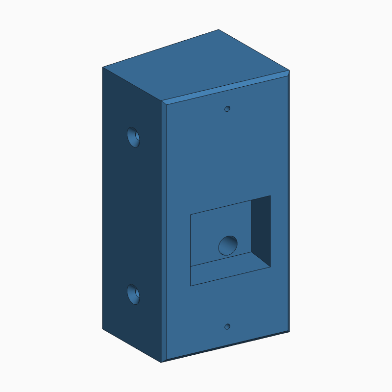
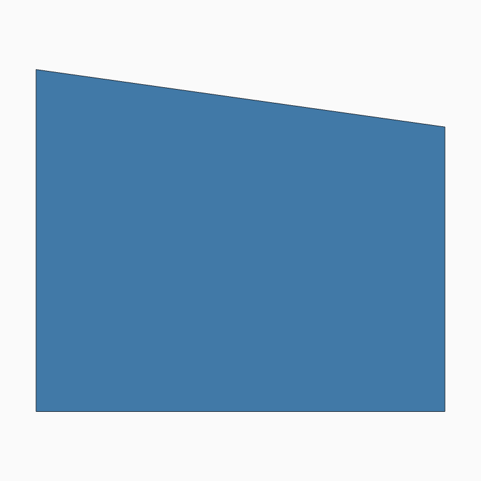
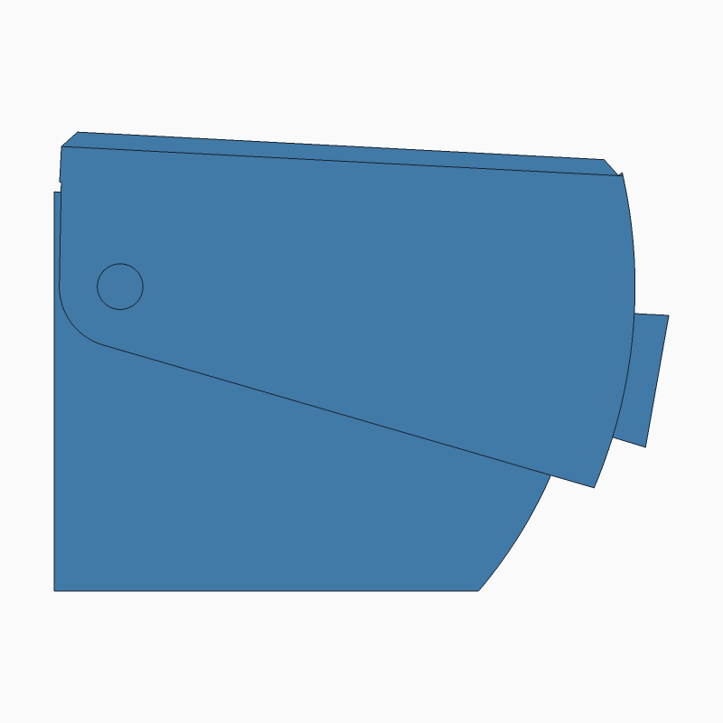
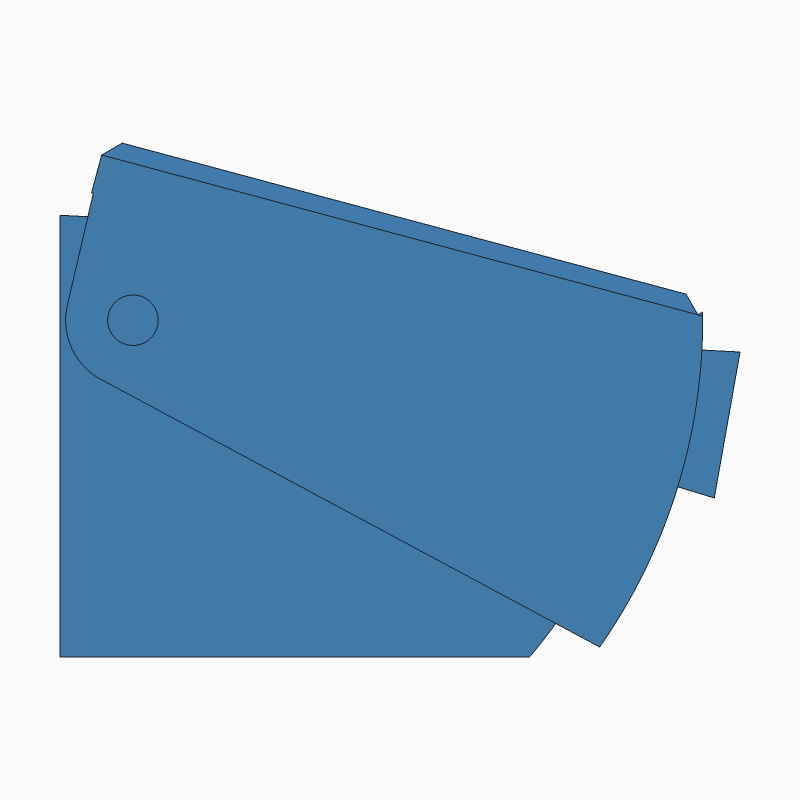
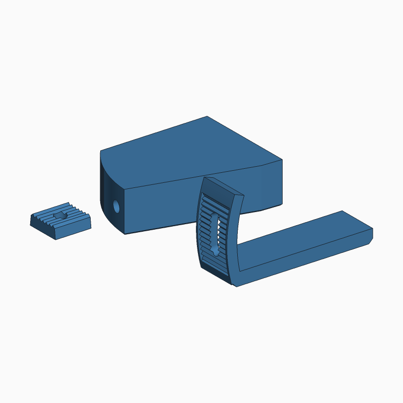
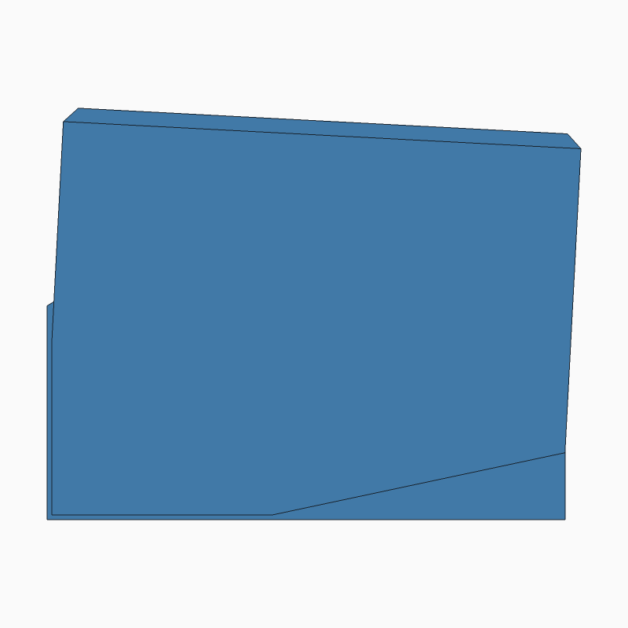
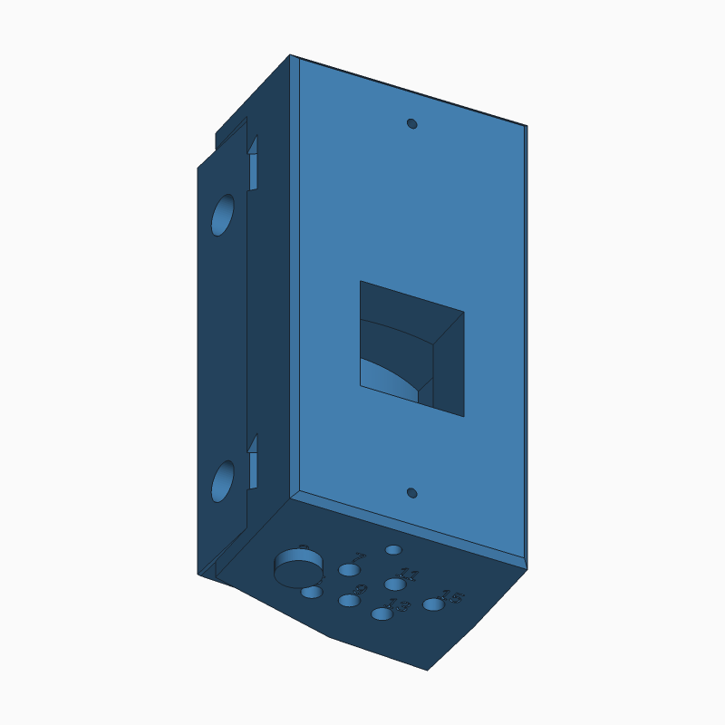
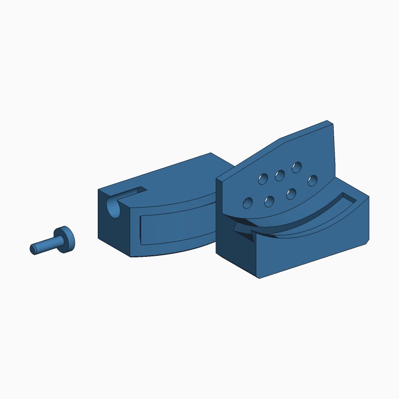

# 3d-print-ring-camera

An angled mounting block for a Ring camera. It screws on through its side and
turns the camera 8° away from the mounting surface. A pocket behind the camera
holds the wiring, and an 8 mm hole carries the cable in from the back.

Two print options:

1. **Solid block** (primary): one piece, fixed 8°. This section.
2. **[Adjustable mount](#adjustable-mount-option-2)** (secondary): a camera
   shell that pivots over a base, set from 3° to 15° in 2° clicks.
3. **[Slide mount](#slide-mount-option-3)** (secondary): adjustable 3°–15°
   with **no metal hardware** apart from the two screws into the wall. The
   shell slides on curved dovetail rails and locks with a printed pin.

**[View the model in 3D →](stl/ring_mount.stl)** (GitHub shows STL files in an interactive viewer)

**Animated demo:** [`demo.html`](demo.html) plays a 90-second walkthrough
(the sketch, both options, the parts, installing each) from the real STLs.
To watch it locally, serve the repo folder (`python -m http.server 8765
--bind 127.0.0.1`) and open `http://localhost:8765/demo.html`. It is also
published as a private Claude artifact. Before republishing, regenerate its
model pack with `python tools/pack_demo.py <out.js>`, because the artifact
host doesn't serve `.stl` files.

| 3D | Camera face | Countersink side | Top |
|---|---|---|---|
|  |  |  |  |

Back face (cable entry): [docs/preview-back.png](docs/preview-back.png).
Original hand sketch: [docs/sketch.webp](docs/sketch.webp).

## Using the model

- **Tinkercad:** Import (top right) → choose `stl/ring_mount.stl` → units mm.
- **Slicer:** print lying on the **back face** (flat, 55 × 110). In that
  position the pocket opens upward and no supports should be needed. Not yet
  test-printed.
- **Material:** for an outdoor mount, PETG or ASA. PLA softens in sun.
  Dremel Eco-ABS: see the material note under the adjustable mount.

## Adjustable mount (option 2)

| 3° | 15° | Angle scale (side) | Fit test |
|---|---|---|---|
|  |  |  |  |

3D: [at 3°](stl/adjustable_assembly_3.stl) · [at 15°](stl/adjustable_assembly_15.stl)
(viewing only; print the parts below).

**How it works.** The **base** screws to the surface exactly like the solid
block: deep side against the surface, two screws through the width, cable in
through the back. The **shell** carries the Ring. It pivots on two M4 bolts
(top and bottom) and wraps over the base, so it looks like one block at every
angle and the base's screw heads end up hidden. The base's shallow end is a
cylinder centred on the hinge, so the shell's curved skirt slides over it with
a constant gap. A **toothed washer** under one clamp bolt locks into teeth on
the skirt: one tooth = 2°. The teeth take the load, not clamp friction, which
matters because plastic slowly creeps under constant load outdoors. **Reading
the angle:** the trailing edge of the skirt points at a scale engraved on the
base (3, 9, 15, with ticks every 2°).

### Parts and print orientation

| STL | Print orientation (as exported) |
|---|---|
| `stl/adjustable_fit_test.stl` | **Print this first.** A 16 mm slice through the clamp: base puck, skirt with teeth and slot, washer. Use it to check the slide and the tooth mesh, and tune tolerances, before the full parts. |
| `stl/adjustable_base.stl` | Standing on its bottom face, so the cylinder prints round. |
| `stl/adjustable_shell.stl` | Camera face down. |
| `stl/adjustable_washer.stl` | Flat face down, teeth up. |

### Hardware (stainless, A2 or A4)

- 2× M4 × 16 bolts: hinge
- 1× M4 × 20 bolt: clamp
- 3× M4 hex nuts: captive in the base
- 2× wood screws, about Ø3.5 × 65 mm: base to surface. The head seats 40 mm
  into the base (`screw_seat_x`).

Bolt lengths are calculated from the model, not yet tested.

### Assembly `[unverified: not yet test-assembled]`

1. Press the two hinge nuts into the slots on the base's mounting face, and
   the clamp nut into the slot on its back face. Each is held captive once the
   base is against the surface or wall.
2. Feed the cable through the back, then screw the base to the surface through
   the two counterbores on its curved side.
3. Slide the shell onto the base from the open, curved side. Line up the hinge
   holes and fit the hinge bolts from the top and from the bottom.
4. Turn the shell to the angle you want and drop the washer into the toothed
   track. Fit the clamp bolt through the washer and the slot into the nut, and
   tighten.
5. Wire the Ring through the window in the shell's camera plate, then screw it
   to the shell.

### Print tolerances

All clearances live in one section at the top of `ring_mount_adjustable.scad`
(`/* [Print tolerances] */`). They are starting values for a 0.4 mm nozzle,
not yet tuned to the DigiLab 3D45:

| Value | Default | Governs |
|---|---|---|
| `gap` | 0.4 | skirt over base, plates over base |
| `tooth_clr` | 0.25 | washer teeth in skirt teeth |
| `bolt_d` | 4.5 | M4 holes |
| `nut_af` / `nut_t` | 7.4 / 3.6 | captive nut slots |
| `washer_side` | 0.3 | washer in its track |
| `swing_clr` | 1.0 | camera plate and Ring bosses vs base, through the swing |
| `foot_chamfer` | 0.5 | base bottom edge, against first-layer squash ("elephant's foot") |

The build's collision check proves the parts clear each other at all seven
settings **at nominal size only**. Real fit needs the fit test.

### Material note

Dremel Eco-ABS is fine for the fit test and a prototype. For outdoor use it is
questionable: a retailer lists its heat deflection at about 78 °C
(unverified). A dark part on a sunny wall can reach 60–70 °C under constant
clamp load, and there is no UV rating. One user review says it is a modified
PLA rather than ABS. Use **PETG** for the outdoor part (the 3D45 prints it),
and prefer a light colour, which runs cooler in sun.

## Slide mount (option 3)

| 3° | 15° | Underside: lock pin and labels | Fit test |
|---|---|---|---|
|  |  |  |  |

3D: [at 3°](stl/slide_assembly_3.stl) · [at 15°](stl/slide_assembly_15.stl)
(viewing only; print the parts below).

**How it works.** The base's front is a curve around a virtual pivot behind
the wall, carrying two curved dovetail rails. The shell's back has matching
grooves. Sliding the shell along the rails turns the camera away from the
mounting surface. The dovetails hold the shell in every other direction, so
there is no hinge and no bolt. **Locking:** a printed pin pushes up from
underneath. The shell's bottom has 7 holes, each engraved with its angle.
Under them, the base has 7 holes laid out so each pair lines up at exactly
one angle. Slide until the pin goes into the hole marked with the angle you
want. The grooves' closed end stops the slide just past 15°. **Weather:**
hoods cover the base's top and bottom, the pin holes face down, and there is
a drain.

| STL | Print orientation (as exported) |
|---|---|
| `stl/slide_fit_test.stl` | **Print this first.** The bottom 26 mm of base and shell plus a pin: checks the dovetail slide and the pin fit. |
| `stl/slide_base.stl` | Standing on its bottom face. Rails print without supports (30° flanks). |
| `stl/slide_shell.stl` | Camera face down. |
| `stl/slide_pin.stl` | Lying on a small flat, so layers run along the pin (strongest in shear). |

**Hardware:** 2 wood screws (about Ø3.5 × 65 mm: the head seats 40 mm into
the base at `screw_seat_x`, plus about 25 mm into the frame). Nothing else.

**Assembly** `[unverified: not yet test-assembled]`:

1. On the bench, slide the shell onto the base's rails from the open side,
   to 3°, and push the pin into the hole marked 3.
2. Feed the cable through the back. Hold the mount in the corner and drive
   the two screws through the counterbores on its open side. At 3° they
   sit below the shell.
3. To set the angle: pull the pin out from below, slide the shell, and push
   the pin into the hole for the new angle.
4. Wire the camera through the window and screw it to the face.

**Same as options 1 and 2** (from `mount_common.scad`): the Ring holes, the
pocket, and the cable hole position (17 mm from the deep side, 35 mm up),
which has to match where the wire leaves the wall, and the screw size.
**Chosen for this design:** the mounting screws sit 10 mm from the back
(options 1 and 2: 19.5), so the heads are below the shell's path. Screw
positions aren't fixed; only their size is. The shell is up to 69 mm wide at
15° because it slides toward the open side.

**Checks in `build.ps1`:** no collisions at all seven angles with the pin in
its hole, and a wrong-hole test (shell at 5°, pin in the "3" hole) that must
be blocked. That second test proves the check can fail.

## Changing the design

The `.scad` files are the single source of truth. The STLs and preview
images are generated from them. Never edit those by hand.

| File | Owns |
|---|---|
| `mount_common.scad` | **Fixed measurements shared by all three options**: envelope, Ring holes (91.5 mm apart), pocket, cable hole, mounting screw size. Change one here and every option follows; the build fails if a model redefines one. Screw *positions* are not fixed, so each model sets its own. |
| `ring_mount.scad` | Solid block |
| `ring_mount_adjustable.scad` | Adjustable mount (`part` selects base / shell / washer / fit_test / assembly) |
| `ring_mount_slide.scad` | Slide mount (`part` selects base / shell / pin / fit_test / assembly) |

1. Edit a value at the top of the right file. To see it live, open the file
   in OpenSCAD (Start menu → OpenSCAD (Nightly)) and press F5.
2. Rebuild everything:

   ```bash
   powershell -ExecutionPolicy Bypass -File .\build.ps1
   ```

   This exports every STL, renders the `docs/*.png` previews, checks each
   printable STL's size and that it is closed (watertight), and runs the
   adjustable mount's collision check at all seven angles. It takes a few
   minutes.
3. Commit the `.scad`, `.stl` and `.png` changes together.

### Tools

| Tool | Version | Why |
|---|---|---|
| OpenSCAD Nightly | 2026.10.31 (`winget install --id OpenSCAD.OpenSCAD.Nightly --exact`) | Builds the STL. The 2021.01 "stable" release is outdated. Nightly is x64 and runs under emulation on this ARM64 laptop. winget does not add it to PATH, so `build.ps1` calls it by full path. |
| Python 3 | 3.13, standard library only | `tools/check_stl.py` (size, volume, watertight) and `tools/render_stl.py` (preview PNGs). |

`tools/render_stl.py` exists because OpenSCAD's own PNG export fails on this
laptop with `Unable to create FBO` (see open items). Rendering from the STL
has one advantage: the previews show exactly the file that gets printed.

## Measurements

**[docs/MEASUREMENTS.md](docs/MEASUREMENTS.md)** lists every measurement for
both mounts: value, source (written / scaled / chosen / tolerance) and notes,
plus each part's built size. `build.ps1` regenerates it from the `.scad` files
on every build, so it can't drift from the model. To change a measurement,
edit the `.scad` file and rebuild; don't edit the table.

### How the sketch was read

- The sketch's front view looks at the camera face. The shallow side is on the
  left, the deep side on the right. Its side view shows the countersunk side.
  This reading assumes third-angle projection, and it is consistent across all
  three views.
- The screws go through the width, with the countersink on the shallow side.
  So the **deep side sits against the mounting surface**.
- The pocket floor is parallel to the camera face, so the Ring's back gets the
  same clearance everywhere. The sketch drew it parallel to the back wall.

## Open items

- [ ] **Ring model:** identify it and confirm the 91.5 mm hole spacing and
      the screw size. That screw size sets `ring_hole_d` (2.25 mm suits a small
      self-tapping screw) and `ring_hole_depth`. *Gate: Ring model known.*
- [ ] **Block screw length:** the screws pass through 55 mm of plastic, so
      they need to be about 75 mm long. A 3.5 mm hole is tight for a typical
      4 mm wood screw. Decide the screw first, then set `screw_d`, or set
      `screw_head_recess` to sink the heads and shorten the screws.
      *Gate: screw chosen.*
- [ ] **Pocket depth:** check that 15 mm clears the Ring's wiring terminals.
      *Gate: Ring model known.*
- [ ] **Angle:** 8° is a starting value. Check the camera's view on site after
      the first print.
- [ ] **Face bevel vs Ring backplate:** the 1.5 mm bevel trims the flat seat
      to about 52.5 × 107 mm. Check the Ring's backplate still sits fully on
      the flat area. *Gate: Ring model known.*
- [ ] **Scaled dimensions:** confirm the 46 mm depth, the pocket position,
      the cable hole position and the screw positions against your original
      intent. They were measured off the sketch.
- [ ] **Clearance:** the cable hole's lower edge sits 1 mm above the pocket's
      bottom wall. Fine for printing, but there is no slack if the cable
      position moves down.
- [ ] **Test print:** print, fit to the Ring and the mounting surface, then
      record the results here.
- [ ] **Adjustable: fit test.** Print `adjustable_fit_test.stl` in Eco-ABS,
      assemble it with an M4 bolt and nut, and check that the skirt slides
      and the washer teeth seat at each click. Tune `/* [Print tolerances] */`
      and record the final values here.
- [ ] **Adjustable: full prototype.** Print, test-assemble and run through
      all seven angles. Confirm the bolt lengths and the screw seat depth.
      *Gate: fit test passed.*
- [ ] **Adjustable: outdoor material.** Confirm PETG is on hand. Reprint the
      prototype in PETG for outdoor use. *Gate: prototype passed.*
- [ ] **Adjustable: clamp robustness.** The toothed washer is small
      (14 × 13 mm, 0.9 mm teeth), sticks out where it can be knocked, and
      one M4 bolt carries the load. Its strength is unverified. If the fit test
      or prototype shows weakness: a larger washer, taller teeth, or a second
      clamp bolt. Option 3 avoids this design entirely.
- [ ] **Slide: fit test.** Print `slide_fit_test.stl` and check the dovetail
      slide (`dove_clr`) and the pin fit (`pin_free`, `pin_snug`). Tune and
      record the final values here.
- [ ] **Slide: pin retention.** The pin is held by a 0.1 mm interference fit
      at the bottom of the base hole. Check that it stays put and can still be
      pulled by hand. *Gate: fit test.*
- [ ] **Slide: groove ends.** The grooves are open on the open side, so rain
      running down that side could enter them. They're horizontal and
      drain out, but check this on site.
- [ ] **Slide: wrong-angle risk on the bench.** Before mounting, the shell can
      slide below 3°, and at 1° the hole marked 11 happens to line up. Once
      mounted, the frame stops the shell at about 2°. Only use the holes
      between 3° and 15°.
- [ ] **Adjustable: water.** A drain hole in the shell's bottom plate covers
      water that gets in. At steep angles there is a gap of up to about 4 mm
      between the shell's deep edge and the mounting surface. Check on site
      whether rain gets in there.
- [ ] **OpenSCAD PNG export fails** (`Unable to create FBO`). Cause not
      traced. Hypothesis: OpenGL offscreen rendering under x64 emulation on
      ARM64. Workaround in place (`tools/render_stl.py`). The workaround can
      stay even if this is fixed.

## Repo layout

```
mount_common.scad             fixed measurements shared by all options
ring_mount.scad               solid block (edit this)
ring_mount_adjustable.scad    adjustable mount (edit this)
ring_mount_slide.scad         slide mount, option 3 (edit this)
build.ps1                     rebuild all STLs + previews + checks
stl/ring_mount.stl            generated: solid block
stl/adjustable_*.stl          generated: base, shell, washer, fit test, assemblies
docs/preview-*.png            generated: solid block views
docs/adjustable-*.png         generated: adjustable mount views
docs/sketch.webp       original hand sketch
tools/check_stl.py     STL size / volume / watertight check
tools/render_stl.py    STL → PNG preview renderer
tools/param_table.py   .scad parameters + STL sizes → docs/MEASUREMENTS.md
```
